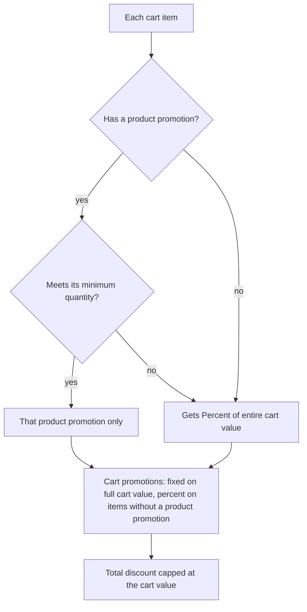

# Promotion Priority & Cart Label Rename – Implementation Plan

**Date:** 2026-10-12 · **Owner:** Suresh · **Status:** Implemented and dev-verified on web and mobile (2026-10-12); SIT pending
**Live doc:** https://claude.ai/code/artifact/cb8b5e58-7ec9-4fb3-9592-21586bbbc3a2

**Source:** Email thread Satish → Divya → Suresh, confirmed by Divya on 2026-10-12. The same rules apply to percentage and fixed-amount promotion types.

## Confirmed requirements

A product, category or subcategory promotion applies only to its own items. "Percent of entire cart value" applies only to the items that did not get such a promotion. "Fixed amount of entire cart value" applies to the whole cart, as today.

**1. Label change**

The seven promotion types stay the same. Only these two labels change.

| Current label | New label |
| --- | --- |
| Percent Off Entire Cart | Percent of entire cart value |
| Fixed Amount Off Entire Cart | Fixed amount of entire cart value |

**2. The seven promotion types**

| Promotion type | Group | Applies on |
| --- | --- | --- |
| Free Shipping | Shipping | Shipping charge only. No change. |
| Fixed amount of entire cart value | Cart promotion | Full cart value. No change. |
| Percent of entire cart value | Cart promotion | Cart value **minus** items that got a product promotion |
| Percentage Off Subcategories | Product promotion | Its own items only |
| Percentage Off Categories | Product promotion | Its own items only |
| Percentage Off Selected Products | Product promotion | Its own items only |
| Fixed Amount Off Selected Products | Product promotion | Its own items only |

In this document, "product promotion" means any of the last four types, and "cart promotion" means either of the two cart types.

**3. Rules**

- A product promotion applies to an item when the item is in the cart, the promotion is active, and the item meets the promotion's minimum quantity on its own. Other items' quantities do not count.
- Several product promotions can be active at once. Each one follows the same rule on its own items.
- Percent of entire cart value is calculated on the items that did not get a product promotion. An item that misses its product promotion's minimum quantity still gets the percent.
- Fixed amount of entire cart value is calculated on the full cart value, as today.
- Cart promotions and product promotions apply together.
- The total discount never exceeds the cart value. Cart promotions never reduce shipping.

**Decisions made for this plan**

- **Stackable switch.** It does not stop cart promotions from applying together with product promotions. Product promotions on different items never block each other, as today.
- **Several cart promotions.** Two Percent of entire cart value promotions both apply on the items without a product promotion. Two Fixed amount of entire cart value promotions both apply on the full cart value.
- **How the customer gets it.** The rules are the same whether the promotion is automatic, click-to-apply or Use code.
- **Maximum discount on a product promotion.** The limit is for the promotion's total across its items, as today.
- **Message.** When Percent of entire cart value does not apply because every item has its own promotion, Cart and Checkout show: "Items in your cart already have their own offer."
- **Coupon wallet.** Wallet and direct coupons still apply after promotions, on the remaining amount. No change.

**4. Example:** Diffuser ₹1,000 × 2 and Candle ₹500 × 1 (cart ₹2,500). Active: Percentage Off Categories 25% on Diffusers, Percent of entire cart value 10%, Fixed amount of entire cart value ₹100.

| Promotion | Today | New rule |
| --- | --- | --- |
| 25% off Diffusers | ₹500 on Diffuser | ₹500 on Diffuser |
| Percent of entire cart value 10% | ₹250 on ₹2,500 | ₹50 on Candle ₹500 only |
| Fixed amount of entire cart value ₹100 | ₹100 | ₹100 |
| **Total discount** | **₹850** | **₹650** (payable ₹1,850) |

**5. Confirmed not to occur**

- A category or subcategory promotion and a Selected Products promotion on the same product.
- Two product promotions on the same product.

## How it works today

Today all active promotions apply to the full cart, so Percent of entire cart value also discounts items that already have a product promotion. The minimum quantity of a product promotion is also added up across all its products instead of being checked per product.

| Area | Today | Needed |
| --- | --- | --- |
| Percent of entire cart value | All items, including items with a product promotion | Only items without a product promotion |
| Product promotion minimum quantity | Added up across its products (Diffuser A × 1 + Diffuser B × 1 counts as 2) | Checked on each product's own quantity |
| Fixed amount of entire cart value | Full cart value | No change |
| Several product promotions | Each on its own items | No change |

**Where the price is calculated.** Web Cart and Checkout call `POST /v2/promotions/calculate`, which runs `evaluatePromotionQuote` in `src/services/promotion-v2-engine.ts`. Older promotion records are converted into the same format by `convertLegacyPromotionRule` (`src/utils/legacy-promotion-v2.ts`), so every promotion goes through this one calculation.

**Labels today.** "Percent Off Entire Cart" and "Fixed Amount Off Entire Cart" are in `asset_management_frontend_aromazen/src/utils/promotionV2Templates.ts` (lines 25–26) and `src/components/promotions/PromotionForm.tsx` (lines 83–84).

## Target behaviour

Product promotions are worked out first, item by item. Then the two cart promotions are worked out: the percent one on the remaining items, the fixed one on the full cart.

**Calculation order for one cart**

1. **Product promotions.** For each item covered by a product promotion, check the minimum quantity on that item alone. If it is met, the item gets that product promotion only. Percentage types apply per item. Fixed Amount Off Selected Products is one amount shared across its qualifying items, as today. Maximum discount limits still apply.
2. **Percent of entire cart value.** Calculated on the value of all items that did not get a product promotion in step 1. If there are no such items, it is not applied.
3. **Fixed amount of entire cart value.** Calculated on the full cart value, as today.
4. **Minimum cart value.** A cart promotion's minimum cart value is checked on the full cart value, as today.
5. **Together.** All qualifying cart promotions apply together with the product promotions.
6. **Limits.** The total discount never exceeds the cart value, and no item goes below ₹0. If an item has no value left for its share of the fixed cart amount, that share moves to other items. Shipping is only reduced by Free Shipping.

**How the code recognises each type**

| Promotion type | Recognised by |
| --- | --- |
| Fixed amount of entire cart value | `type = FIXED_AMOUNT_OFF_CART` |
| Percent of entire cart value | `type = PERCENT_OFF_CART` |
| The four product promotion types | Rule scope has products, categories or subcategories |
| Free Shipping | `type = FREE_SHIPPING` (no change) |

## Implementation changes

The logic change is in the V2 calculation. The admin change is the two labels. No new types, no data migration.

**Backend (`asset-management-backend`)**

| File | Change |
| --- | --- |
| `src/utils/promotionGroup.ts` (new) | `getPromotionGroup(promotion)` returns `CART_FIXED`, `CART_PERCENT`, `PRODUCT` or `SHIPPING`, using the table above. |
| `src/services/promotion-v2-engine.ts` | Add `group` to `PromotionCampaign`. In `evaluatePromotionQuote`, work out `PRODUCT` promotions first with the per-item minimum quantity check and keep the list of items they apply to. Build `CART_PERCENT` on the remaining items only. Cart promotions never block product promotions or each other. In `capSelectedCandidates`, move a fixed cart share off an item at ₹0 to other items. |
| `src/services/promotions-v2.service.ts` | Set `group` in `activeCampaigns` (lines ~401 and ~455) and in `simulate` (line ~181). In `checkEligibility`, work out the Percent of entire cart value card with the product promotions present, so the saving shown matches the final price. |
| `src/utils/legacy-promotion-v2.ts` | Comment wording only (new labels). |
| `src/services/promotion-evaluation.service.ts` | No change. Only used when the V2 calculation has no rule. Confirm in testing that it is not reached. |
| `tests/promotionV2Engine.test.ts` | One test per case in the two test sections below. |

**Admin (`asset_management_frontend_aromazen`)**

| File | Change |
| --- | --- |
| `src/utils/promotionV2Templates.ts` (lines 25–26) | "Fixed amount of entire cart value" and "Percent of entire cart value". |
| `src/components/promotions/PromotionForm.tsx` (lines 83–84) | Same labels. The percent description says it skips items that have a product promotion. |

**Storefront (`Nivaana-Ecom-Web`)**

- No price calculation on the client. The quote from `/v2/promotions/calculate` already carries the totals and per-item amounts.
- Check that the Cart and Checkout price breakdown shows the new Percent of entire cart value amount.
- Search the mobile app for the old labels before release.
- Show "Items in your cart already have their own offer." when Percent of entire cart value does not apply because every item has its own promotion.

**Process**

- Commit to `DEV-NEW` only. Leave out debug and env files.
- Log each fix in `docs/Fix_After_Sep30/Master.md`.

## Positive test cases

Every case below goes through `/v2/promotions/calculate` and shows the same totals on Cart and Checkout. Shipping is left out unless the case says otherwise.

**Test data**

| Product | Category | Price |
| --- | --- | --- |
| Diffuser A | Diffusers | ₹1,000 |
| Diffuser B | Diffusers | ₹800 |
| Candle | Candles | ₹500 |
| Oil | Oils | ₹300 |

| ID | Promotion type | Setup |
| --- | --- | --- |
| P1 | Percentage Off Categories | 25% off Diffusers, minimum quantity 2 |
| P2 | Percent of entire cart value | 10% |
| P3 | Fixed amount of entire cart value | ₹100 |
| P4 | Fixed Amount Off Selected Products | ₹50 off Candle |
| P5 | Percentage Off Categories | 20% off Oils |
| P6 | Fixed Amount Off Selected Products | ₹100 off Diffuser A and Candle |
| P7 | Fixed amount of entire cart value | ₹200, minimum cart value ₹2,500 |
| P8 | Percent of entire cart value | 10%, maximum discount ₹30 |
| P9 | Percent of entire cart value | 5% |
| P10 | Fixed amount of entire cart value | ₹50 |
| P11 | Percentage Off Categories | 25% off Diffusers, minimum quantity 2, maximum discount ₹300 |

**Cases**

| ID | Scenario | Cart | Active | Expected |
| --- | --- | --- | --- | --- |
| TC-P01 | Cart has only product-promotion items | Diffuser A × 2 | P1, P2, P3 | Diffuser A ₹500. No item left for P2, so not applied. P3 ₹100. Total ₹600. |
| TC-P02 | Confirmed example | Diffuser A × 2, Candle × 1 (₹2,500) | P1, P2, P3 | ₹500 + ₹50 (10% of Candle) + ₹100 = ₹650. Payable ₹1,850. |
| TC-P03 | Below minimum quantity, item gets P2 | Diffuser A × 1, Candle × 1 | P1, P2, P3 | P1 not met. P2 on ₹1,500 = ₹150. P3 ₹100. Total ₹250. |
| TC-P04 | Minimum quantity is per product | Diffuser A × 1, Diffuser B × 1 | P1, P2 | Neither reaches 2. P2 on ₹1,800 = ₹180. |
| TC-P05 | One product meets the minimum, the other does not | Diffuser A × 2, Diffuser B × 1 | P1, P2 | Diffuser A ₹500. P2 on Diffuser B ₹800 = ₹80. Total ₹580. |
| TC-P06 | Several product promotions active | Diffuser A × 2, Candle × 1, Oil × 1 | P1, P4, P5, P2, P3 | Diffuser A ₹500, Candle ₹50, Oil ₹60. No item left for P2. P3 ₹100. Total ₹710. |
| TC-P07 | Fixed Amount Off Selected Products with P2 | Candle × 1, Oil × 1 | P4, P2 | Candle ₹50. P2 on Oil ₹300 = ₹30. Total ₹80. |
| TC-P08 | Fixed Amount Off Selected Products on two products | Diffuser A × 1, Candle × 1, Oil × 1 | P6, P2 | P6 ₹100 split ₹66.67 / ₹33.33. P2 on Oil = ₹30. Total ₹130. |
| TC-P09 | Only cart promotions | Candle × 1, Oil × 1 (₹800) | P2, P3 | ₹80 + ₹100 = ₹180. Payable ₹620. |
| TC-P10 | Minimum cart value checked on full cart value | Diffuser A × 2, Candle × 1 (₹2,500) | P1, P2, P7 | P7 applies. ₹500 + ₹50 + ₹200 = ₹750. |
| TC-P11 | Maximum discount on P8 | Candle × 2, Oil × 1 (₹1,300) | P8 | 10% = ₹130, limited to ₹30. |
| TC-P12 | Quantity change | Diffuser A × 1 then × 2, Candle × 1 | P1, P2 | Qty 1: P2 on ₹1,500 = ₹150. Qty 2: ₹500 + ₹50 = ₹550. |
| TC-P13 | Shipping kept separate | Candle × 1, shipping ₹150 | P3, then add Free Shipping | P3 only: items ₹400, shipping ₹150. With Free Shipping: shipping ₹0. |
| TC-P14 | Web and mobile match | TC-P02 cart | P1, P2, P3 | Same ₹650 on web and mobile. |
| TC-P15 | New labels | Admin list filter, create and edit screens | — | Show the two new labels. Existing promotions of these types still load and apply. |
| TC-P16 | Two Percent of entire cart value active | Diffuser A × 2, Candle × 1 | P1, P2, P9 | Diffuser A ₹500. P2 ₹50 and P9 ₹25, both on Candle. Total ₹575. |
| TC-P17 | Two Fixed amount of entire cart value active | Candle × 1, Oil × 1 (₹800) | P3, P10 | ₹100 + ₹50 = ₹150. Payable ₹650. |
| TC-P18 | Promotions given as Use code or click-to-apply | Diffuser A × 2, Candle × 1 | P1 (click-to-apply), P2 (Use code), P3 | Same as TC-P02: ₹650. |
| TC-P19 | Maximum discount on a product promotion | Diffuser A × 2, Diffuser B × 2 (₹3,600) | P11 | 25% = ₹900, limited to ₹300 for the promotion in total, shared across both products. |

## Negative and edge test cases

An item only skips Percent of entire cart value while its product promotion actually applies. If the product promotion cannot be used for any reason, the item gets Percent of entire cart value. Test data is the same as above.

**Product promotion cannot be used, so the item gets P2**

| ID | Scenario | Cart | Active | Expected |
| --- | --- | --- | --- | --- |
| TC-N01 | Product promotion inactive or expired | Diffuser A × 2 | P1 (inactive), P2, P3 | P2 on ₹2,000 = ₹200. P3 ₹100. Total ₹300. |
| TC-N02 | Product promotion not on this channel | Diffuser A × 2, on mobile | P1 (web only), P2, P3 | Total ₹300. |
| TC-N03 | Product promotion usage limit or budget used up | Diffuser A × 2 | P1 (limit reached), P2, P3 | Total ₹300. |
| TC-N04 | Customer not in the product promotion's audience | Diffuser A × 2 | P1 (group only), P2, P3 | Total ₹300. |
| TC-N05 | Product promotion with value 0 | Candle × 1 | ₹0 off Candle, P2 | P2 on ₹500 = ₹50. |
| TC-N06 | Product removed from cart | Candle × 1 left | P1, P2 | P2 ₹50. P1 not applied. |

**Cart promotions**

| ID | Scenario | Cart | Active | Expected |
| --- | --- | --- | --- | --- |
| TC-N07 | Minimum cart value not met | Diffuser A × 2 (₹2,000) | P1, P7 | P7 not applied. Diffuser A ₹500 unchanged. |
| TC-N08 | Cart promotion with Stackable off | Diffuser A × 2, Candle × 1 | P1, P2, P3 (Stackable off) | All three still apply. Total ₹650. |
| TC-N09 | Every item has a product promotion | Diffuser A × 2, Oil × 1 | P1, P5, P2 | Diffuser A ₹500, Oil ₹60. P2 not applied. |

**Limits and rounding**

| ID | Scenario | Cart | Active | Expected |
| --- | --- | --- | --- | --- |
| TC-N10 | Discounts larger than the cart | Oil × 1 (₹300) | ₹250 off Oil, P3 | Total limited to ₹300. Payable ₹0, never negative. Shipping unchanged. |
| TC-N11 | Fixed cart share on an item already at ₹0 | Oil × 1, Candle × 1 | ₹300 off Oil, P3 | Oil ₹300. All of P3's ₹100 goes to Candle. Total ₹400. |
| TC-N12 | Odd prices | Products priced like ₹333 | P1, P2, P3 | Amounts round down to the paise. Cart, Checkout and payment amount match exactly. |

**Confirmed not to occur (kept safe)**

| ID | Scenario | Expected |
| --- | --- | --- |
| TC-N13 | Percentage Off Categories and Percentage Off Selected Products on the same product | The bigger saving applies to that item. No double discount. |

**Regression**

| ID | Scenario | Expected |
| --- | --- | --- |
| TC-N14 | Cart changes between price check and payment | Payment is refused and the cart is priced again. |
| TC-N15 | Promotion card saving in Cart / Checkout | The Percent of entire cart value card shows ₹50 in TC-P02, not ₹250, matching the final price. |
| TC-N16 | Order saved with item-wise amounts (TC-P02 cart) | Diffuser line ₹2,000 − ₹500 − ₹80 (its share of ₹100) = ₹1,420. Candle line ₹500 − ₹50 − ₹20 = ₹430. Order total ₹1,850. Percent of entire cart value saved on Candle only. |
| TC-N17 | Return / refund on that order | Return 1 Candle → refund ₹430. Return 1 of 2 Diffusers → refund ₹710. |
| TC-N18 | Message when Percent of entire cart value does not apply (TC-P01) | Cart and Checkout show "Items in your cart already have their own offer." |
| TC-N19 | Wallet / direct coupon after promotions | TC-P02 cart plus a ₹100 wallet coupon → payable ₹1,750. Promotion amounts unchanged. |

## Notes, risks and rollout

Nothing is blocking the build. The main risk is that carts with product-promotion items will get a smaller Percent of entire cart value discount than today, so it needs a dry run on live promotions before release.

**Notes**

- The mail Divya confirmed had a "5% of entire cart value = ₹125 on ₹2,500" row. Under this rule it becomes ₹25 (5% of the Candle's ₹500), because Diffuser has its own promotion. Mention this when sharing the build.
- A cart promotion's minimum cart value is still checked on the full cart value, as today.
- Free Shipping does not change.

**Risks**

| Risk | Mitigation |
| --- | --- |
| Percent of entire cart value gives less on carts with product-promotion items (₹850 → ₹650 in the example) | Before release, run `/v2/promotions/:id/simulate` on sample carts for every active promotion. Share the before/after with Divya. |
| Promotion card saving differs from the final price | `checkEligibility` change and TC-N15. |
| Web and mobile disagree | Both use the same endpoint. TC-P14 covers it. |

**Rollout**

1. Build and unit tests on `DEV-NEW`.
2. SIT with all positive and negative cases.
3. Dry run on a copy of production promotions. Share results with Divya and Satish.
4. UAT sign-off from Satish.
5. Production release following `docs/SIT_UAT_PROD_DEPLOYMENT_RUNBOOK.md`.

## Implementation status (2026-10-12)

All plan items are implemented and verified on dev (web and mobile). Fix log: `Master.md`, PLAN-2026-10-12-107.

| Area | Status | Where |
| --- | --- | --- |
| Calculation rules (product promotions first, per-item minimum quantity, Percent of entire cart value on remaining items, Fixed amount of entire cart value on the full cart, Stackable never blocks cart promotions, fixed share moves off items at ₹0) | Done | backend `promotionGroup.ts`, `promotion-v2-engine.ts`, `promotions-v2.service.ts` |
| Percent of entire cart value card shows the final saving (TC-N15) | Done | `eligibilityCardCampaigns` |
| Tests for TC-P01–P19 and TC-N01–N19 | Done (engine level; channel, audience, payment, refund and wallet steps checked in dev) | `tests/promotionV2Engine.test.ts` |
| Admin labels (list filter, Type column, create / edit) | Done | Inventory `promotionV2Templates.ts`, `PromotionForm.tsx`, `PromotionsPage.tsx` |
| "Items in your cart already have their own offer." | Done: web Cart / Checkout card and on Apply; mobile on Apply | Ecom `cartPromotions.ts`; mobile `promotionOfferEligibility.ts` |
| Old labels in the mobile app | None found | — |

**Follow-ups found in dev testing (all done):**

1. Cart / Free Shipping promotions kept a leftover V2 rule from an earlier type (promotion 75 showed "Percentage Off Categories" and priced one category). Saving now retires it; `scripts/retire-stale-cart-rule-versions.ts` for existing records (run per environment).
2. Order lines lost the quote's item-wise amounts after payment (TC-N16 / TC-N17). Lines now keep them; only the direct coupon is spread on what is left after promotions.
3. GST on coupon orders was calculated before the coupon. Line GST is now recalculated after the coupon, reusing the order's GST type.

**Dev orders checked:**

| Order | Channel | Case | Result |
| --- | --- | --- | --- |
| 175 | web | promotions only (before follow-up 2) | Totals right; lines flattened → follow-up 2 |
| 176 | web | promotions only | Lines and GST match the quote |
| 177 | web | ₹100 wallet | Wallet as payment; lines and GST unchanged |
| 178 | web | ₹50 coupon (before follow-up 3) | Coupon split right; GST on pre-coupon amount → follow-up 3 |
| 179 | web | ₹60 coupon | Coupon split and GST match the amount paid |
| 180 | mobile | promotions only | Identical to web 176 (TC-P14) |
| 181 | mobile | ₹100 wallet | Same as web 177 |
| 182 | mobile | ₹50 coupon | Coupon split and GST match the amount paid |

**Open before release:**

- Push the mobile commit (`expo_rn_migrations_v2`) and run the SIT / UAT / prod steps in `docs/RELEASE_SCRIPTS_CHECKLIST.md`.
- Accounts: wallet credits that come from coupons are spent as a payment (GST on full price, restored on return), while the same coupon used directly is a discount (GST after coupon, not restored).
- Agree the refund rule for COD orders that used the wallet.
- Repair script for older orders (flattened lines, GST before coupon); skip orders that already have an invoice.
- MRP discount is counted twice in order line / header fields (amounts paid, refunds and GST are correct); kept as is until the 3 UIs are checked.
- Mobile shows the own-offer message only on Apply (mobile hides offers that do not qualify).

